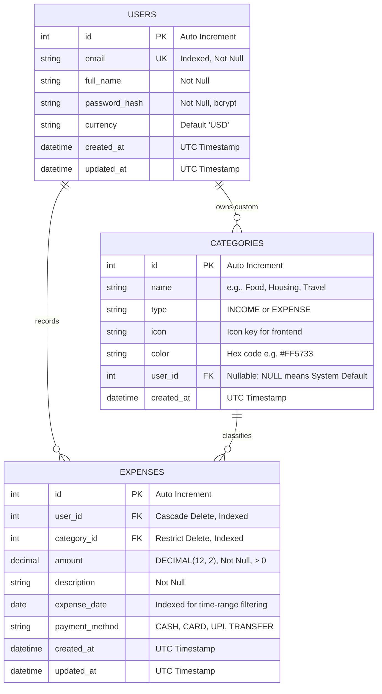
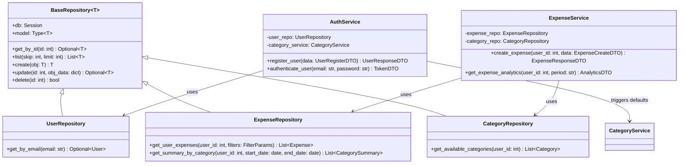

# Phase 1: High-Level Design (HLD) & Low-Level Design (LLD)
## Foundation & Personal Expense Management (FastAPI + MySQL + React)

Welcome to the architectural masterclass for **Phase 1** of our Expense Tracker and Splitwise platform. In this phase, we lay down a scalable, clean, enterprise-grade foundation. 

Even though this phase focuses on personal expense tracking (CRUD, authentication, and categorization), we design it with the foresight of **Phase 2 (Splitwise Engine)**, **Phase 3 (Race Conditions & High Concurrency)**, **Phase 4 (Rate Limiting)**, and **Phase 5 (Asynchronous Background Workers)**.

---

## 1. High-Level Design (HLD)

### 1.1 Architectural Pattern: Clean Layered Architecture
We adopt a **4-Tier Layered Architecture** (Presentation -> Application/Service -> Domain/Repository -> Infrastructure).

```mermaid
flowchart TD
    subgraph ClientLayer["Frontend Client (React + Vite)"]
        UI["React SPA (Components, Hooks, TanStack Query)"]
    end

    subgraph APIGateway["Presentation Layer (FastAPI)"]
        Router["API Routers (Endpoints, Auth Guards, DTO Validation)"]
    end

    subgraph ServiceLayer["Business Logic Layer (Services)"]
        AuthSvc["Auth Service (JWT, Passwords)"]
        ExpenseSvc["Expense Service (Business Rules, Aggregates)"]
        CategorySvc["Category Service (Defaults, Hierarchy)"]
    end

    subgraph RepositoryLayer["Data Access Layer (Repositories)"]
        UserRepo["User Repository"]
        ExpenseRepo["Expense Repository"]
        CategoryRepo["Category Repository"]
    end

    subgraph DataStore["Persistence Layer (MySQL 8.0 InnoDB)"]
        DB[("MySQL Database (ACID Compliant)")]
    end

    UI -->|HTTPS / JSON REST API| Router
    Router --> AuthSvc
    Router --> ExpenseSvc
    Router --> CategorySvc

    AuthSvc --> UserRepo
    ExpenseSvc --> ExpenseRepo
    ExpenseSvc --> CategoryRepo
    CategorySvc --> CategoryRepo

    UserRepo -->|SQLAlchemy ORM (Unit of Work)| DB
    ExpenseRepo -->|SQLAlchemy ORM (Unit of Work)| DB
    CategoryRepo -->|SQLAlchemy ORM (Unit of Work)| DB
```

### 1.2 Technology Selection & Rationale

#### Why Python & FastAPI over Django or Flask?
| Dimension | Flask | Django | FastAPI (Our Choice) |
| :--- | :--- | :--- | :--- |
| **I/O Model** | WSGI (Synchronous by default) | WSGI / ASGI (Heavyweight) | Native ASGI (Asynchronous, Non-blocking) |
| **Validation** | Manual or third-party (Marshmallow) | Built-in Forms / Serializers | **Pydantic v2** (Rust-backed, fastest schema validation) |
| **Documentation** | Manual Swagger configuration | DRF Swagger / Spectacular plugins | **Automated OpenAPI / Swagger** out of the box |
| **Type Safety** | Optional, not enforced | Dynamic ORM attributes | Native Python 3.10+ Type Hints enforced at runtime |
| **Flexibility** | High, but leaves too many decisions | Low (Batteries-included monolith) | **Ideal modularity**: microservice ready or clean modular monolith |

#### Why MySQL (InnoDB) over MongoDB or PostgreSQL?
* **Financial Integrity:** Financial data is strictly relational. Storing monetary balances across users, groups, and splits requires strict foreign keys, relational constraints, and table joins.
* **ACID Transactions:** MySQL’s InnoDB storage engine provides full ACID guarantees, row-level locking (`SELECT ... FOR UPDATE`), and Multi-Version Concurrency Control (MVCC), which is critical for Phase 3 when multiple users settle shared expenses simultaneously.
* **DECIMAL Precision:** MySQL provides exact fixed-point `DECIMAL(12, 2)` storage, preventing the classic IEEE 754 floating-point rounding errors (e.g., `0.1 + 0.2 = 0.30000000000000004`).

---

### 1.3 Entity-Relationship Diagram (ERD)



---

## 2. Low-Level Design (LLD)

### 2.1 Package & Folder Organization

We follow the **Modular Layered Architecture**:
```text
backend/
├── app/
│   ├── core/                    # Infrastructure & Cross-cutting concerns
│   │   ├── config.py            # Environment configurations (Pydantic Settings)
│   │   ├── database.py          # SQLAlchemy Engine, SessionLocal, Base
│   │   ├── security.py          # Hashing (bcrypt) & JWT token encoding/decoding
│   │   └── dependencies.py      # Dependency injection providers (db, current_user)
│   ├── models/                  # SQLAlchemy ORM Entities (Database schemas)
│   │   ├── user.py
│   │   ├── category.py
│   │   └── expense.py
│   ├── schemas/                 # Pydantic DTOs (Request / Response validation)
│   │   ├── user.py
│   │   ├── category.py
│   │   ├── expense.py
│   │   └── token.py
│   ├── repositories/            # Data Access Layer (Abstraction over DB queries)
│   │   ├── base.py              # Generic CRUD Base Repository
│   │   ├── user_repository.py
│   │   ├── category_repository.py
│   │   └── expense_repository.py
│   ├── services/                # Business Logic Layer
│   │   ├── auth_service.py
│   │   ├── category_service.py
│   │   └── expense_service.py
│   ├── api/                     # Presentation Layer (HTTP / JSON)
│   │   └── v1/
│   │       ├── auth.py
│   │       ├── categories.py
│   │       ├── expenses.py
│   │       └── router.py
│   └── main.py                  # FastAPI Application Factory
├── tests/                       # Unit & Integration Tests (Pytest)
├── requirements.txt
└── .env.example
```

---

### 2.2 Class Diagram & Structural Contracts



---

## 3. The SOLID Principles Applied in Practice

Here is exactly how our Phase 1 codebase implements each of the **SOLID** principles:

### 1. Single Responsibility Principle (SRP)
* **Definition:** A class or module should have one, and only one, reason to change.
* **Our Implementation:**
  * **Routers (`api/v1/expenses.py`):** Only responsible for reading HTTP request headers/body, validating via Pydantic, and serializing the HTTP response.
  * **Service (`services/expense_service.py`):** Only responsible for business invariants (e.g., verifying whether a category belongs to the user, computing summary aggregates).
  * **Repository (`repositories/expense_repository.py`):** Only responsible for database queries and translating them to ORM objects.

### 2. Open/Closed Principle (OCP)
* **Definition:** Software entities should be open for extension, but closed for modification.
* **Our Implementation:**
  * `BaseRepository[T]` defines standard CRUD operations. When `ExpenseRepository` requires complex date-range filtering or category aggregations, we *extend* `BaseRepository` without modifying its core logic.
  * When Phase 2 introduces `GroupExpense`, we will inherit from or compose with the base patterns without breaking single-user personal expenses.

### 3. Liskov Substitution Principle (LSP)
* **Definition:** Objects of a superclass should be replaceable with objects of its subclasses without breaking application correctness.
* **Our Implementation:**
  * Our service layer accepts any repository adhering to `AbstractRepository[T]` (or `BaseRepository`).
  * In our test suite, we can substitute `MySQLUserRepository` with an `InMemoryUserRepository` or `MockUserRepository` without modifying a single line of `AuthService`.

### 4. Interface Segregation Principle (ISP)
* **Definition:** Clients should not be forced to depend on methods they do not use.
* **Our Implementation:**
  * Pydantic schemas are segregated: `ExpenseCreate` contains only input fields (no `id`, no `created_at`), while `ExpenseResponse` includes computed fields.
  * Repository interfaces are clean and specialized rather than one giant "God Database Helper".

### 5. Dependency Inversion Principle (DIP)
* **Definition:** High-level modules should not depend on low-level modules. Both should depend on abstractions.
* **Our Implementation:**
  * `ExpenseService` does not instantiate `db = SessionLocal()` directly.
  * Instead, FastAPI's Dependency Injection (`Depends(get_expense_service)`) wires dependencies top-down:
    `Database Session -> Repository -> Service -> Controller`.

---

## 4. Financial Integrity & ACID in Phase 1

Even in personal finance, ACID principles must be strictly enforced:

### A - Atomicity (All or Nothing)
* **Scenario:** When a new user signs up, the system must create the user record AND seed their account with default categories (e.g., Food, Rent, Salary).
* **Guaranteed by:** A single database transaction. If category seeding fails (e.g., constraint error), the transaction is rolled back (`db.rollback()`), preventing orphaned "half-created" users.

### C - Consistency (Valid State Invariants)
* **Rules Enforced at the Engine Level:**
  * Foreign key: An expense cannot reference a non-existent `category_id`.
  * Check constraint / Application invariant: `amount > 0`.
  * Unique constraint: `users.email` is unique.
* **No invalid state can be written to the database.**

### I - Isolation (Concurrency Boundaries)
* **MySQL InnoDB Default:** `REPEATABLE READ`.
* Uses Multi-Version Concurrency Control (MVCC) and snapshot reads so queries read consistent data without locking tables, while write operations lock the specific row to prevent lost updates.

### D - Durability (Persistence Guarantee)
* Once `db.commit()` returns success, data is written to MySQL's Write-Ahead Log (WAL / Redo Log) on non-volatile disk. Even if the server loses power immediately after, the transactions will be replayed upon reboot.

