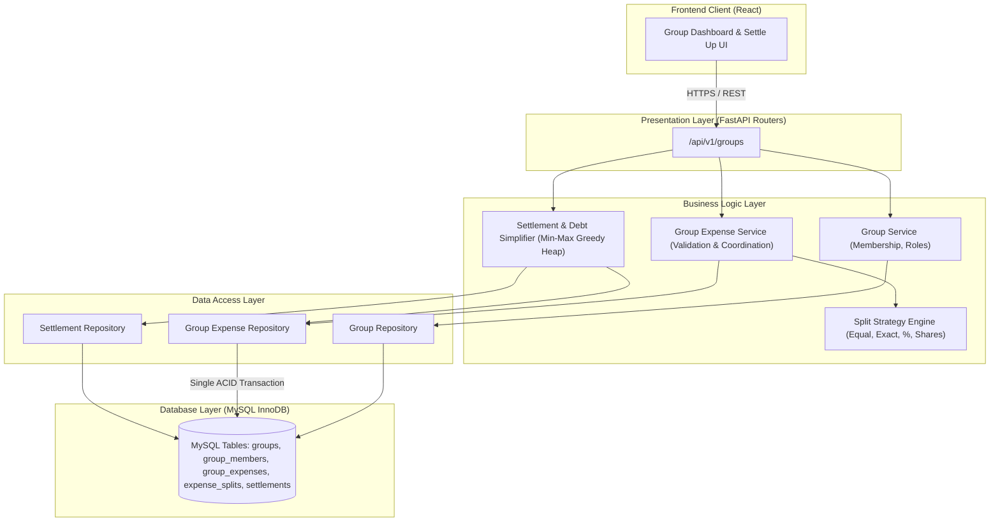
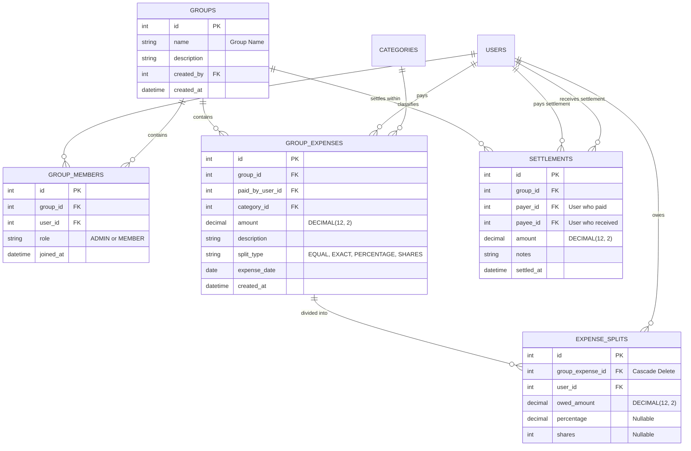
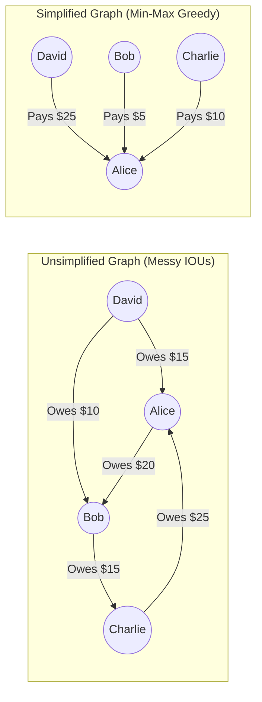
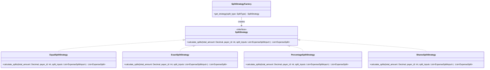

# Phase 2: High-Level Design (HLD) & Low-Level Design (LLD)
## The Splitwise Multi-User Engine & Debt Simplification

In **Phase 1**, we built a clean, personal single-user expense manager.
In **Phase 2**, we transform the platform into a **collaborative social ledger (Splitwise engine)**.

When multiple people share expenses (e.g., apartment roommates, group trips, dinner parties), two major architectural challenges emerge:
1. **Dynamic Splitting Invariants:** Expenses are rarely split equally; people require exact amounts, percentages, or shares. How do we ensure mathematical consistency and penny-rounding accuracy without corrupting the ledger?
2. **The $N(N-1)$ Debt Explosion:** If 5 friends take a trip, tracking 20 separate pairwise IOUs creates chaotic, redundant transfers. How do we reduce this to at most $N-1$ optimal settlements?

---

## 1. High-Level Design (HLD)

### 1.1 Architecture & Domain Boundary

Phase 2 builds directly on top of our Phase 1 Layered Architecture, introducing two new domain aggregates: **The Group Aggregate** and **The Settlement / Debt Aggregate**.



---

### 1.2 Entity-Relationship Diagram (ERD)



---

### 1.3 The Debt Simplification Graph Algorithm

#### The Problem: Dense Debt Networks
Suppose 4 friends go on vacation:
* Alice paid \$100 for groceries (\$25 each).
* Bob paid \$60 for gas (\$15 each).
* Charlie paid \$120 for dinner (\$30 each).

Without debt simplification, every pair tracks independent IOUs. In an $N$-person group, the number of pairwise transactions is up to $\frac{N(N - 1)}{2}$. For 10 people, that is **45 potential transactions**.

#### The Mathematical Insight: Net Balance Invariant
Internal debts in a closed group form a **zero-sum game**:
$$\sum_{i=1}^N \text{Net Balance}_i = 0$$
Where:
$$\text{Net Balance}_i = \text{Total Paid by User } i - \text{Total Owed by User } i + \text{Settlements Received} - \text{Settlements Paid}$$

If a user's net balance is:
* **$> 0$:** They are a **Creditor** (the group owes them money).
* **$< 0$:** They are a **Debtor** (they owe money to the group).
* **$= 0$:** They are completely settled up.

#### The Simplification Algorithm (Greedy Max-Debtor & Max-Creditor):
Instead of maintaining pairwise history, we greedily pair the largest debtor with the largest creditor:
1. Compute the net balance for each member in the group.
2. Filter into two lists:
   * `Debtors`: Members with balance $< 0$ (stored in a max-heap keyed by absolute debt).
   * `Creditors`: Members with balance $> 0$ (stored in a max-heap keyed by credit).
3. In each step:
   * Pop the maximum debtor $D$ (owes $\$X$) and maximum creditor $C$ (owed $\$Y$).
   * Calculate settlement amount: $M = \min(X, Y)$.
   * Record transaction: **$D$ pays $C$ amount $M$**.
   * Update balances: $D \leftarrow X - M$, $C \leftarrow Y - M$.
   * If $D > 0$, re-insert $D$ into the debtor heap; if $C > 0$, re-insert $C$ into the creditor heap.
4. **Guaranteed Bound:** The algorithm terminates in at most **$N - 1$ transactions**, minimizing bank transfer friction!



---

## 2. Low-Level Design (LLD)

### 2.1 The Strategy Pattern for Dynamic Splitting

In object-oriented design, business rules that vary by type should not be implemented using massive `if/elif/else` blocks. Doing so violates the **Open/Closed Principle (OCP)**.

We define an abstract base class `SplitStrategy` and implement concrete strategies:



#### The Remainder Penny Problem (Fractional Cents)
When \$100 is split among 3 people:
$$100 / 3 = 33.333333...$$
* If everyone owes \$33.33, $\sum = \$99.99$ (lost 1 cent!).
* If everyone owes \$33.34, $\sum = \$100.02$ (gained 2 cents!).

**Our Invariant:** The sum of all splits MUST equal the total amount down to the exact penny:
$$\sum_{j=1}^N \text{owed\_amount}_j = \text{total\_amount}$$
**Resolution:** `EqualSplitStrategy` calculates the floor cent (\$33.33) and allocates the leftover penny difference (\$0.01) to the payer or first participant, ensuring strict mathematical balance.

---

### 2.2 ACID Multi-Record Transactions in Phase 2

In Phase 1, creating an expense was a single-row write. In Phase 2:
1. User creates a Group Expense for \$150.
2. System creates 1 `group_expenses` row.
3. System creates 4 `expense_splits` rows.

If creating split #4 fails (e.g. database disconnect, participant left group), the entire operation must rollback:

```python
# Unit of Work / Transaction Boundary
try:
    group_expense = GroupExpense(...)
    db.add(group_expense)
    db.flush() # Generates group_expense.id without committing

    for split in splits:
        split.group_expense_id = group_expense.id
        db.add(split)
        
    db.commit() # Atomic commit of header + all splits
except Exception:
    db.rollback() # No partial/orphaned splits remain
    raise
```

---

## 3. SOLID Principles in Phase 2

1. **Single Responsibility Principle (SRP):**
   * `DebtSimplifier`: Only responsible for net balance calculations and greedy graph reductions.
   * `SplitStrategyFactory`: Only responsible for providing the appropriate algorithm.
   * `GroupExpenseService`: Only responsible for coordinating domain operations.
2. **Open/Closed Principle (OCP):**
   * If we need to support an `AdjustmentSplit` (e.g., someone pays \$10 extra for drinks), we create a new `AdjustmentSplitStrategy` subclass. Zero modification to `GroupExpenseService`.
3. **Liskov Substitution Principle (LSP):**
   * Any `SplitStrategy` can be passed to the expense creation pipeline without unexpected side effects.
4. **Interface Segregation Principle (ISP):**
   * `ExpenseSplitInput` DTO separates optional fields (`percentage`, `shares`, `amount`) based on split context.
5. **Dependency Inversion Principle (DIP):**
   * Services receive repositories via dependency injection (`Depends(get_group_expense_repository)`), decoupling database I/O from domain business logic.

