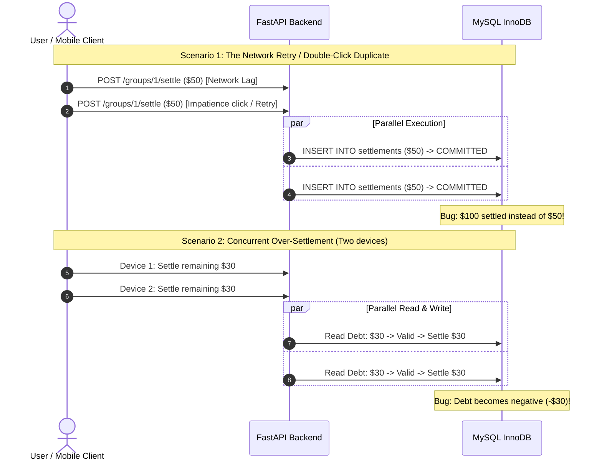
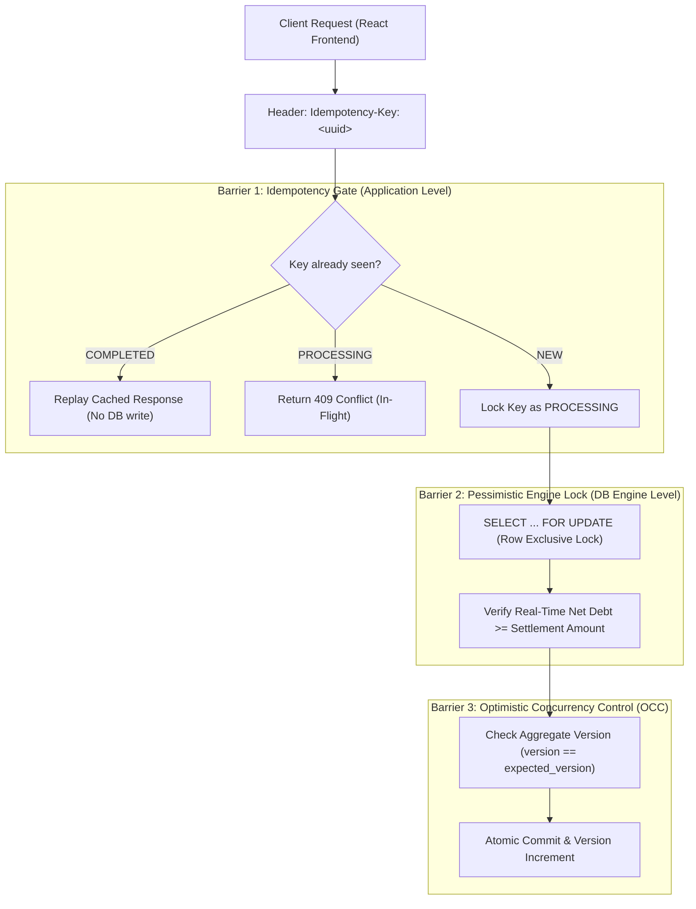
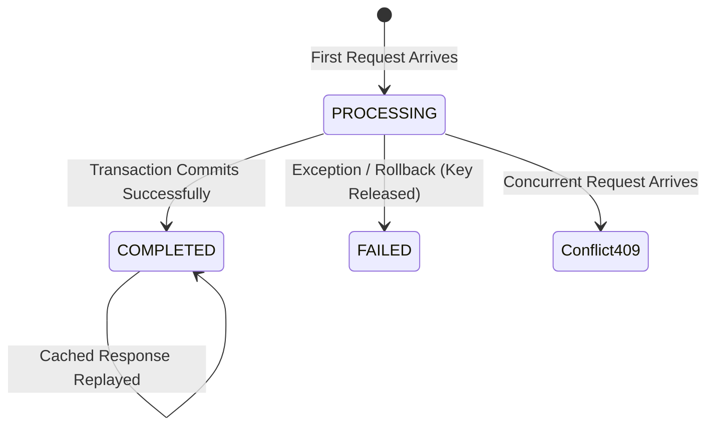
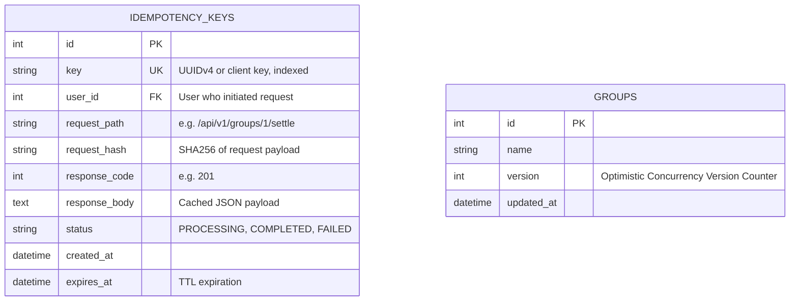
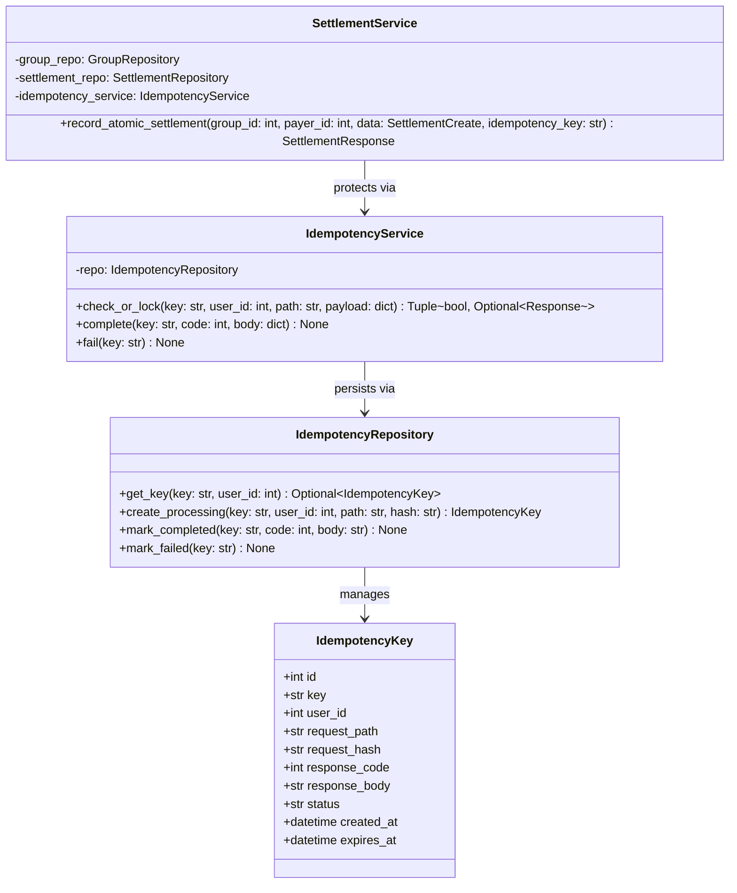

# Phase 3: High-Level Design (HLD) & Low-Level Design (LLD)
## Concurrency Control, Race Conditions & Financial Integrity

In **Phase 1**, we built the single-user personal ledger.
In **Phase 2**, we implemented the multi-user Splitwise engine and debt simplification.

Now in **Phase 3**, we enter the critical realm of **distributed financial reliability**. When multiple users or unreliable mobile networks interact with financial systems simultaneously, race conditions and duplicate operations can corrupt balances, lead to double charges, or create ghost debts.

---

## 1. High-Level Design (HLD)

### 1.1 The Anatomy of Financial Race Conditions

In distributed and web systems, three classic race conditions threaten financial integrity:



---

### 1.2 Architectural Solution: The 3 Pillars of Concurrency Control

To guarantee mathematical and transactional correctness under high load, Phase 3 implements three complementary defensive barriers:



---

### 1.3 Barrier 1: The Idempotency Key Pattern (IETF Standard)

* **Definition:** An operation is *idempotent* if performing it multiple times produces the exact same result as performing it once ($f(f(x)) = f(x)$).
* **The IETF Draft Standard (`Idempotency-Key`):**
  1. The client generates a unique `UUIDv4` for every transactional mutation (e.g. `POST /settle`, `POST /expenses`).
  2. The server creates an `idempotency_keys` record with status `PROCESSING`.
  3. If another request arrives with the **same key while in-flight**, the server rejects it immediately with **`HTTP 409 Conflict`** ("Transaction currently processing, please wait").
  4. Once the transaction successfully commits, the server stores the HTTP status code and response body in the record, updating status to `COMPLETED`.
  5. If the client repeats the request (e.g. timeout retry), the server **replays the cached response directly** without touching business logic or writing duplicate database rows!



---

### 1.4 Barrier 2: Database Locking & ACID Isolation Levels

#### MySQL InnoDB Transaction Isolation Levels
| Isolation Level | Dirty Read? | Non-Repeatable Read? | Phantom Read? | Used When? |
| :--- | :--- | :--- | :--- | :--- |
| **READ UNCOMMITTED** | Yes | Yes | Yes | Never in financial apps. |
| **READ COMMITTED** | No | Yes | Yes | High throughput, lower locking contention. |
| **REPEATABLE READ** (MySQL Default) | No | No | No (via Next-Key Locks) | Default for consistent snapshot reads. |
| **SERIALIZABLE** | No | No | No | Strict serial execution (highest locking overhead). |

#### Why `REPEATABLE READ` snapshot reads are not enough for writes:
In `REPEATABLE READ`, MVCC (Multi-Version Concurrency Control) gives every transaction a **snapshot view** of past committed data.
If Transaction 1 and Transaction 2 both query:
```sql
SELECT sum(owed) - sum(paid) FROM ... WHERE user_id = 5;
```
Both see debt = $\$50$. Both transactions proceed to insert a $\$50$ settlement. Result: $\$100$ settled!

#### The Fix: Pessimistic Row Locking (`SELECT ... FOR UPDATE`)
We force the database engine to acquire an **exclusive lock (`X-lock`)** on the target aggregate row:
```sql
SELECT * FROM groups WHERE id = :group_id FOR UPDATE;
```
* The first transaction to arrive acquires the lock.
* Any other transaction attempting to settle debts or add expenses within that group is forced by InnoDB to **wait in a hardware-efficient queue** until the first transaction commits or rolls back.
* The second transaction then reads the freshly committed data and recognizes the debt is already paid!

---

## 2. Low-Level Design (LLD)

### 2.1 Entity Additions & Schema Updates



---

### 2.2 Class Diagram & Structural Contracts



---

## 3. SOLID Principles in Phase 3

1. **Single Responsibility Principle (SRP):**
   * `IdempotencyService` is strictly responsible for request deduplication, payload hashing, and cached response replay. It has zero knowledge of financial calculations or group balances.
   * `SettlementService` handles the business invariants of debt clearance and delegates concurrency gates to dedicated abstractions.
2. **Open/Closed Principle (OCP):**
   * The `IdempotencyRepository` can swap backends (e.g. database table vs Redis `SETNX`) without modifying `IdempotencyService` or any API routers.
3. **Liskov Substitution Principle (LSP):**
   * Any storage provider adhering to `BaseRepository[IdempotencyKey]` or `AbstractIdempotencyStorage` can be seamlessly substituted during testing (e.g., fast in-memory dictionaries for unit test suites).
4. **Interface Segregation Principle (ISP):**
   * Client APIs provide optional `X-Idempotency-Key` headers. If provided, the idempotency layer activates transparently; if omitted, standard transactional persistence executes without requiring mock tokens.
5. **Dependency Inversion Principle (DIP):**
   * Routers and services receive the `IdempotencyService` via FastAPI's `Depends()` dependency injection container.

