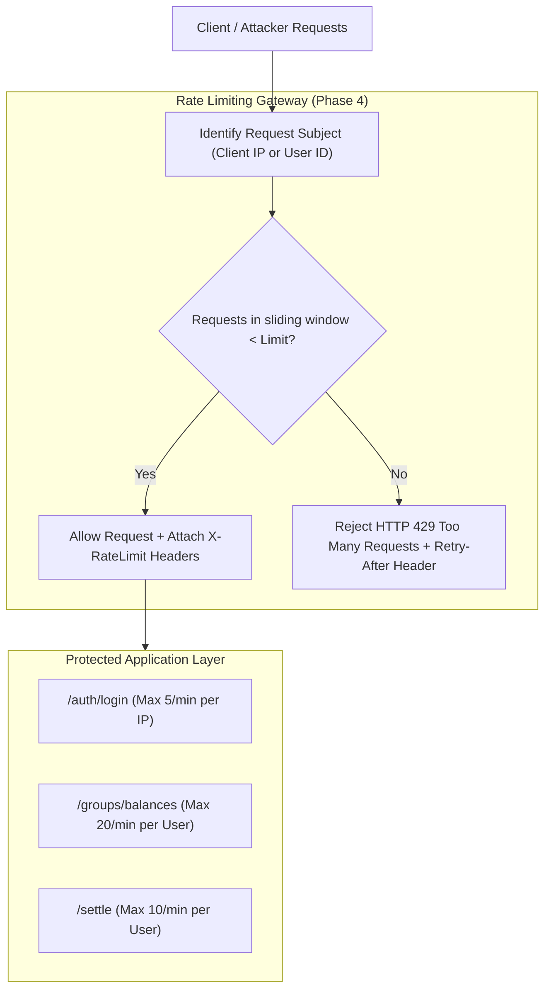
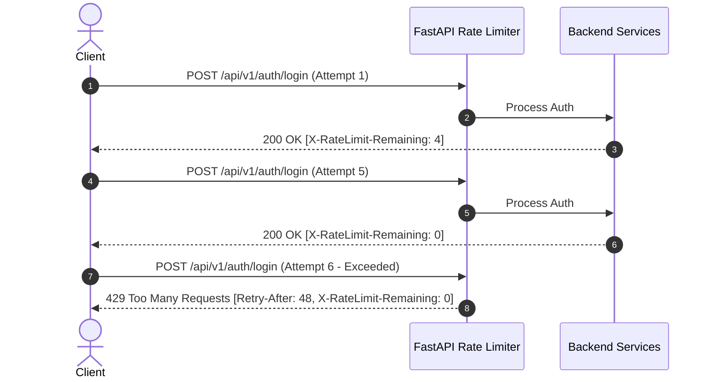
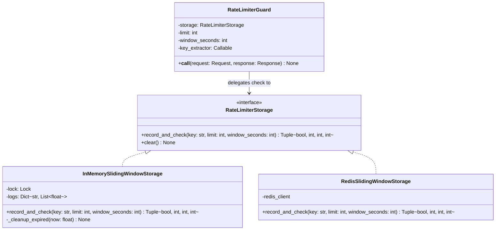

# Phase 4: High-Level Design (HLD) & Low-Level Design (LLD)
## Rate Limiting, API Throttling & Security Defense

In **Phase 1**, we laid the database and personal expense foundations.
In **Phase 2**, we built the Splitwise collaborative engine and greedy debt simplification.
In **Phase 3**, we established ACID financial reliability with idempotency keys and database row locks.

Now in **Phase 4**, we harden our platform against **abuse, brute-force attacks, and distributed denial-of-service (DDoS)** through **Multi-Tier Rate Limiting and API Throttling**.

---

## 1. High-Level Design (HLD)

### 1.1 The Threat Landscape in Financial APIs

Financial systems are prime targets for automated abuse:
1. **Credential Stuffing & Brute Force:** Automated bots attempting thousands of email/password combinations against `/api/v1/auth/login`.
2. **Denial of Service (DoS) via Heavy Endpoints:** Repetitively calling computationally heavy endpoints—such as `/api/v1/groups/{id}/balances` (which runs the graph simplification algorithm across all historical transactions) to consume server CPU and memory.
3. **Transaction Flooding:** Automated scripts bombarding `/settle` or `/expenses` to overwhelm database connection pools.

---

### 1.2 Comparison of Rate Limiting Algorithms

| Algorithm | How it Works | Pros | Cons | Verdict |
| :--- | :--- | :--- | :--- | :--- |
| **Fixed Window Counter** | Counts requests in fixed time blocks (e.g. 12:00-12:01). | Extremely simple; low memory footprint. | **Boundary Spike Flaw:** A client can send max quota at 12:00:59 and another max quota at 12:01:01, doubling throughput at boundaries. | Unacceptable for security-critical endpoints. |
| **Token Bucket** | Tokens refill at steady rate; request consumes 1 token. | Allows controlled bursts while maintaining long-term average. | Requires state synchronization for fractional token refills. | Good for APIs allowing bursts. |
| **Leaky Bucket** | Requests queue up and leak out at a constant rate. | Smooth, predictable processing rate. | Bursts are delayed or dropped; queue memory overhead. | Better for traffic shaping than API gating. |
| **Sliding Window Log (Our Choice)** | Tracks exact timestamp log of requests within rolling window (e.g. $[t - W, t]$). | **100% accurate; zero boundary spikes.** Guaranteed mathematically strict enforcement. | Memory proportional to limit per window. | **Optimal for financial security.** |

---

### 1.3 HTTP Standard Headers for Rate Limiting

When an endpoint is protected by rate limiting, standard IETF HTTP headers inform clients of their current consumption:

* **`X-RateLimit-Limit`:** The maximum request quota allowed within the time window.
* **`X-RateLimit-Remaining`:** The number of remaining requests available before being throttled.
* **`X-RateLimit-Reset`:** The Unix epoch timestamp when the current window expires and quota fully resets.
* **`Retry-After`:** In case of **`HTTP 429 Too Many Requests`**, the number of seconds the client must wait before retrying.

---

## 2. Low-Level Design (LLD)

### 2.1 Component Architecture & Storage Strategy

We follow the **Dependency Inversion Principle (DIP)**: the rate limiting pipeline depends on an abstract storage interface `RateLimiterStorage`.

---

### 2.2 Multi-Tier Rate Limiting Policies

We apply customized rate limiting policies depending on the security profile and computational cost of each endpoint:

1. **Tier 1: Authentication & Public Mutation (Strict by IP)**
   * Target: `POST /api/v1/auth/login`, `POST /api/v1/auth/register`
   * Policy: **5 requests per 60 seconds per IP**
   * Rationale: Prevents credential stuffing, dictionary attacks, and bulk registration spam.
2. **Tier 2: Financial Settlements & Mutations (Controlled by User ID)**
   * Target: `POST /api/v1/groups/{id}/settle`, `POST /api/v1/groups/{id}/expenses`
   * Policy: **15 requests per 60 seconds per User ID**
   * Rationale: Prevents script bots from flooding database transactions.
3. **Tier 3: Heavy Algorithmic Aggregations (Moderate by User ID)**
   * Target: `GET /api/v1/groups/{id}/balances`, `GET /api/v1/expenses/summary`
   * Policy: **30 requests per 60 seconds per User ID**
   * Rationale: Prevents resource exhaustion from graph simplification and multi-table joins.

---

## 3. SOLID Principles in Phase 4

1. **Single Responsibility Principle (SRP):**
   * The `RateLimiterGuard` and `RateLimiterStorage` classes have one and only one responsibility: tracking request frequencies and enforcing quotas. Route handlers contain zero rate-limiting logic.
2. **Open/Closed Principle (OCP):**
   * New storage backends (e.g. transitioning from thread-safe `InMemorySlidingWindowStorage` to a distributed cluster `RedisSlidingWindowStorage`) implement `RateLimiterStorage` without modifying endpoint dependencies.
3. **Liskov Substitution Principle (LSP):**
   * `InMemorySlidingWindowStorage` and `RedisSlidingWindowStorage` can be swapped interchangeably without altering rate limiter guard behavior.
4. **Interface Segregation Principle (ISP):**
   * Separate key extractor strategies: `get_client_ip` for unauthenticated requests and `get_authenticated_user_id` for session requests.
5. **Dependency Inversion Principle (DIP):**
   * FastAPI dependency injection injects the configured rate limiter into endpoint routes via `Depends(RateLimiter(...))`.
