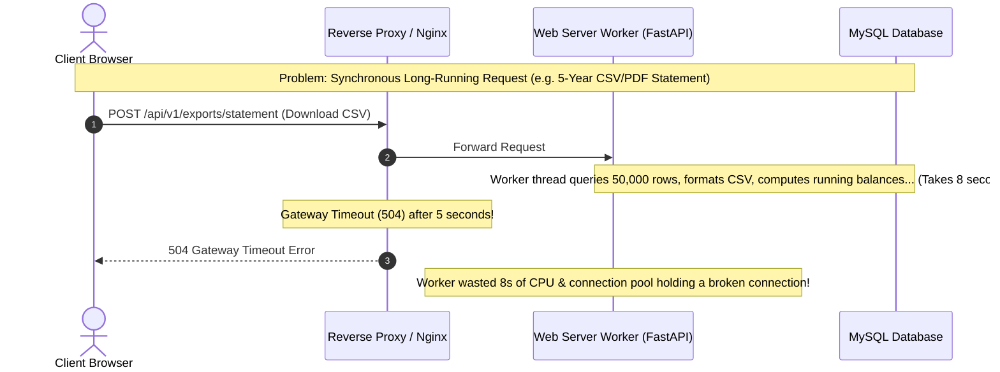
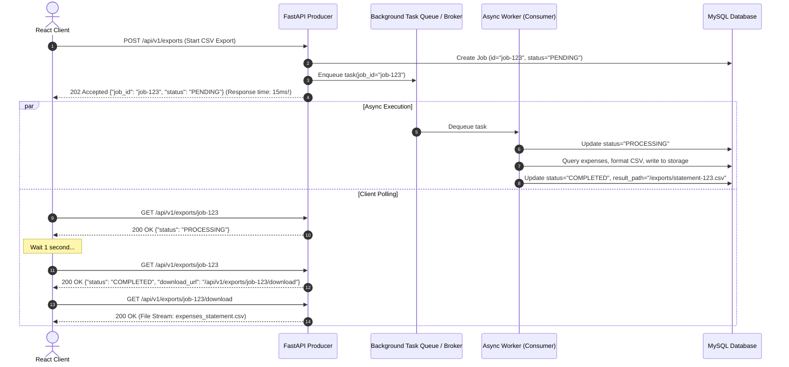
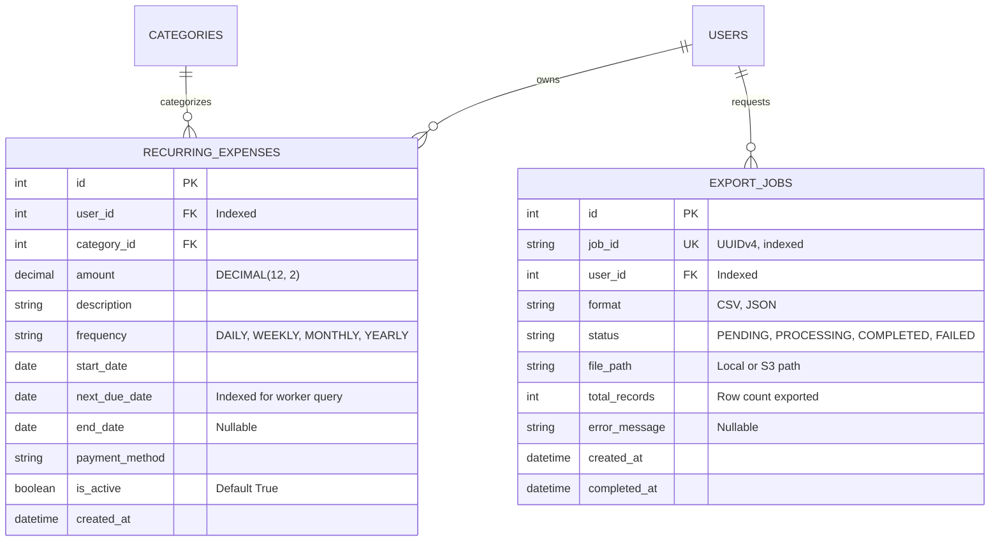
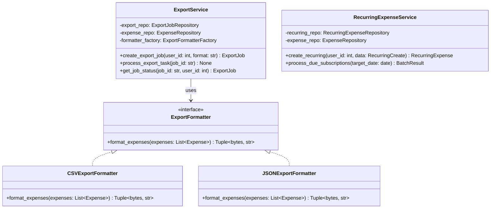

# Phase 5: High-Level Design (HLD) & Low-Level Design (LLD)
## Background Processing, Asynchronous Task Queues & Scheduled Jobs

In **Phase 1**, we built the core single-user ledger.
In **Phase 2**, we implemented the Splitwise multi-user engine with debt simplification.
In **Phase 3**, we enforced ACID financial reliability with idempotency keys and row locks.
In **Phase 4**, we protected our APIs with sliding window rate limiting and security gates.

Now in **Phase 5**, we complete the enterprise architecture by solving the **Synchronous Request Bottleneck** through **Asynchronous Background Processing, Recurring Expense Automation, and Out-of-Band Financial Exports**.

---

## 1. High-Level Design (HLD)

### 1.1 The Synchronous Request Bottleneck

In a traditional web application, HTTP request-response cycles are strictly synchronous: the client sends a request, the server thread handles it, and the client waits until completion.

**The Core Rule of Production Web Architecture:**
> **HTTP requests must complete in $< 100\text{ms}$.** 
> Any task that takes longer—such as generating analytical exports, sending notification emails, or processing recurring subscription batches—must be offloaded out-of-band to a **Background Worker**.

---

### 1.2 The Asynchronous Job Pattern (Producer-Consumer)

Instead of making the client wait for a long task, we implement the **Asynchronous Polling & Job Pattern**:

---

### 1.3 The Recurring Expenses Engine (Automated Subscriptions)

Many personal expenses repeat on a fixed cadence:
* Monthly rent, Netflix subscription, Gym membership, Weekly groceries, Utility bills.

Instead of requiring users to manually re-enter these transactions, we implement an **Automated Recurring Subscriptions Engine**:
1. Users define a `RecurringExpense` rule:
   * `amount`, `category_id`, `description`, `frequency` (`DAILY`, `WEEKLY`, `MONTHLY`, `YEARLY`), `next_due_date`, `is_active`.
2. A scheduled cron / background worker executes periodically (e.g. daily at midnight or triggered via maintenance API):
   * Queries all active recurring rules where `next_due_date <= today`.
   * **Atomic Transaction per Rule:** For each due subscription, it inserts a concrete `expenses` transaction and advances `next_due_date` to the subsequent cycle (e.g. $+ 1 \text{ month}$).
   * **Failure Isolation:** If subscription #3 fails, it rolls back individually without aborting subscriptions #1 and #2.

---

## 2. Low-Level Design (LLD)

### 2.1 Entity Additions & Schema Updates

---

### 2.2 Component Architecture & The Strategy Pattern for Exports

To ensure the export system can scale to multiple file formats (CSV, PDF, Excel) without modifying the service pipeline, we use the **Strategy Pattern**:

---

## 3. SOLID Principles in Phase 5

1. **Single Responsibility Principle (SRP):**
   * `CSVExportFormatter` is solely responsible for serializing domain expenses into RFC 4180 compliant CSV bytes.
   * `ExportService` coordinates job state transitions (`PENDING` $\to$ `PROCESSING` $\to$ `COMPLETED`).
   * `RecurringExpenseService` calculates date advances and coordinates subscription generation.
2. **Open/Closed Principle (OCP):**
   * Adding support for PDF or Excel statements requires writing one new `PDFExportFormatter` subclass implementing `ExportFormatter`. The `ExportService` remains completely untouched.
3. **Liskov Substitution Principle (LSP):**
   * Any `ExportFormatter` implementation returns `(file_bytes, mime_type)` conforming strictly to the interface contract.
4. **Interface Segregation Principle (ISP):**
   * DTOs for recurring expense creation (`RecurringExpenseCreate`) are segregated from generated batch execution reports (`BatchProcessResult`).
5. **Dependency Inversion Principle (DIP):**
   * Background task handlers receive repositories and database sessions through dependency injection rather than tight static coupling.

---

## 4. ACID Invariants in Asynchronous Batch Processing

When processing hundreds of recurring subscription rules at midnight:
* **The Granular Transaction Boundary Rule:**
  Never run an entire batch of hundreds of subscriptions inside a single giant database transaction. If rule #87 fails (e.g. deleted custom category or database constraint), a monolithic transaction would abort rules #1 through #86!
* **Our Solution (Per-Item Atomicity):**
  Each recurring item creates a real expense and advances `next_due_date` within its own atomic `db.commit()`. If an individual rule fails, its specific transaction rolls back (`db.rollback()`), logs the error, and the batch runner continues safely to the next subscription.
