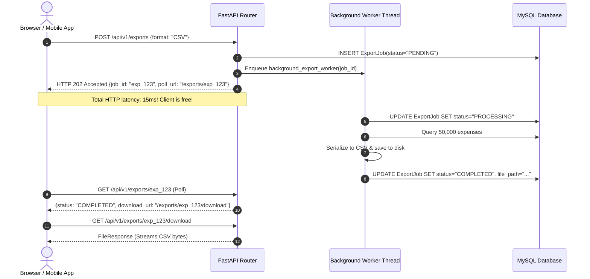

# Phase 5: Background Processing & Asynchronous Jobs (Python Backend Guide)

> **Welcome to Phase 5!**  
> In Phase 1 through 4, we built an ACID-compliant, race-condition-proof, rate-limited expense and Splitwise platform.
> In **Phase 5**, we decouple heavy, slow operations from the synchronous HTTP request/response cycle using **FastAPI Background Tasks**, the **HTTP 202 Accepted Asynchronous Polling Pattern**, and an automated **Recurring Subscriptions Engine** with calendar month clamping.

---

## 1. What Changes Were Made From Phase 4 to Phase 5?

### A. New Files Added:
1. **Database Models (`app/models/`):**
   - `recurring_expense.py`: Defines the `RecurringExpense` rule (frequency: DAILY, WEEKLY, MONTHLY, YEARLY, `next_due_date`, optional `end_date`, `is_active`).
   - `export_job.py`: Defines the `ExportJob` state machine tracking background file generation (`job_id`, `format`, `status`: `PENDING` $\rightarrow$ `PROCESSING` $\rightarrow$ `COMPLETED` / `FAILED`, `file_path`, `total_records`).
2. **Schemas (`app/schemas/`):**
   - `recurring_expense.py`: `RecurringExpenseCreate`, `RecurringExpenseResponse`, `BatchProcessResult`.
   - `export_job.py`: `ExportJobCreate`, `ExportJobResponse`, `ExportStatusResponse`.
3. **Repository Layer (`app/repositories/`):**
   - `recurring_expense_repository.py`: Efficient querying of due subscriptions (`next_due_date <= target_date`).
   - `export_job_repository.py`: Manages export job state transitions (`mark_processing`, `mark_completed`, `mark_failed`).
4. **Service Layer (`app/services/`):**
   - `export_formatters.py`: Implements the **Strategy Pattern** for serializing financial data:
     - `CSVExportFormatter`: Generates RFC 4180 CSV bytes prepending the UTF-8 Byte Order Mark (`\ufeff`) so Microsoft Excel displays non-ASCII characters without encoding glitches.
     - `JSONExportFormatter`: Generates formatted JSON array bytes.
   - `export_service.py`: Dispatches background workers via FastAPI `BackgroundTasks`, isolates database sessions, writes files to disk, and streams downloads via `FileResponse`.
   - `recurring_expense_service.py`: Orchestrates recurring expense templates, advances due dates with calendar clamping, and commits each subscription in an isolated transaction.
5. **Presentation Layer (`app/api/v1/`):**
   - `recurring.py`: CRUD for recurring subscription rules + `POST /recurring/process-due` engine trigger.
   - `exports.py`: `POST /exports` (returns `202 Accepted`), `GET /exports/{job_id}` (poll status), and `GET /exports/{job_id}/download` (file streaming).
6. **Automated Tests (`tests/test_background_jobs.py`):**
   - 4 tests covering date advancement arithmetic, subscription batch execution, auto-deactivation after `end_date`, and the complete async CSV/JSON export lifecycle.

### B. Existing Files Modified:
- `app/api/v1/router.py`: Mounted the `/recurring` and `/exports` routers.
- `app/core/dependencies.py`: Added dependency providers for recurring and export repositories and services.

---

## 2. Why Were These Changes Made? (Deep Pedagogical Dive)

### A. The "HTTP 202 Accepted" Asynchronous Pattern
**The Problem:** Generating a 3-year financial export for an active user requires querying 50,000 rows, formatting CSV bytes, and writing to disk. This can take 5–10 seconds.
If done synchronously inside a normal `POST /export`:
1. The client browser hangs with a spinning wheel.
2. If Nginx or Cloudflare has a 15-second timeout, the connection drops with `504 Gateway Timeout`.
3. The FastAPI worker thread is blocked, preventing other users from using the app.

#### The Solution: Decoupling with `202 Accepted`


---

### B. The "Closed Session" Bug in Background Tasks
In FastAPI, `get_db` yields a database session that is closed when the HTTP request finishes.
If a background worker tries to use the request's database session:
`ResourceClosedError: This Connection is closed!`

#### The Solution: Independent Session Factory
In `app/services/export_service.py`:
```python
def background_export_worker(job_id: str, ...):
    # Opens its own independent Unit of Work database session!
    db: Session = database.SessionLocal()
    try:
        ...
    finally:
        db.close() # Always cleaned up
```

---

### C. Calendar Month-End Clamping in Recurring Subscriptions
Naively adding 30 days (`current_date + timedelta(days=30)`) drifts calendar dates (e.g. rent due on the 1st slowly moves to the 28th, then 26th).
Furthermore, what happens if a subscription starts on **January 31st**?
- Next month is February, which only has 28 days (or 29 in a leap year).
- Calling `date(2026, 2, 31)` crashes Python with `ValueError: day is out of range for month`!

In `app/services/recurring_expense_service.py`:
```python
max_days = calendar.monthrange(new_year, new_month)[1]
new_day = min(current_date.day, max_days)
return date(new_year, new_month, new_day)
```
- January 31 $\rightarrow$ **February 28** (clamped to month end).
- February 29 (Leap year) $\rightarrow$ **February 28** (next non-leap year).

---

### D. Granular Transaction Isolation in Batch Processing
When `process_due_subscriptions()` runs at midnight to generate 1,000 users' recurring bills:
- If subscription #450 encounters a validation error (e.g. deleted category), we **must not** rollback the other 999 users' subscriptions!
- Each recurring subscription executes inside its own try/except with its own `db.commit()` and `db.rollback()`. Single failures are logged, while the batch continues uninterrupted.

---

## 3. Benefits & Covered Gaps

| Capability | Phase 4 API Security | Phase 5 Background Processing |
| :--- | :--- | :--- |
| **Large File Exports** | Blocks HTTP cycle; 504 Timeouts | Decoupled via `202 Accepted` polling |
| **Export Formats** | Hardcoded | Strategy Pattern (`CSV` with BOM, `JSON`) |
| **Subscriptions** | Manual entry every month | Automated recurring cron engine |
| **Date Arithmetic** | N/A | Safe calendar clamping & leap-year handling |
| **Batch Transactions** | Monolithic rollback risk | Granular per-item commit isolation |

---

## 4. What Gaps Still Remained for Phase 6?

Even with background workers and subscriptions, our system has one major real-world limitation:
**It only supports a single currency (USD)!**
In international travel groups:
- Alice pays **€100.00 EUR** for museum tickets in Paris.
- Bob pays **£45.00 GBP** for train tickets in London.
- The shared group base currency is **USD (\$)**.

How do we convert, triangulate, and simplify debts without exchange rate drift retroactively changing past liabilities? This is solved in **Phase 6** with the Multi-Currency & Real-Time FX Engine!

---

## 5. How to Run and Test Phase 5 Standalone

```powershell
# 1. Navigate to phase5 directory
cd phase5

# 2. Run all Phase 5 tests (26 tests)
$env:PYTHONPATH="c:\Users\PC\Downloads\tracer\phase5"
..\venv\Scripts\pytest tests -v

# 3. Start the server
..\venv\Scripts\uvicorn app.main:app --reload --port 8000
```
